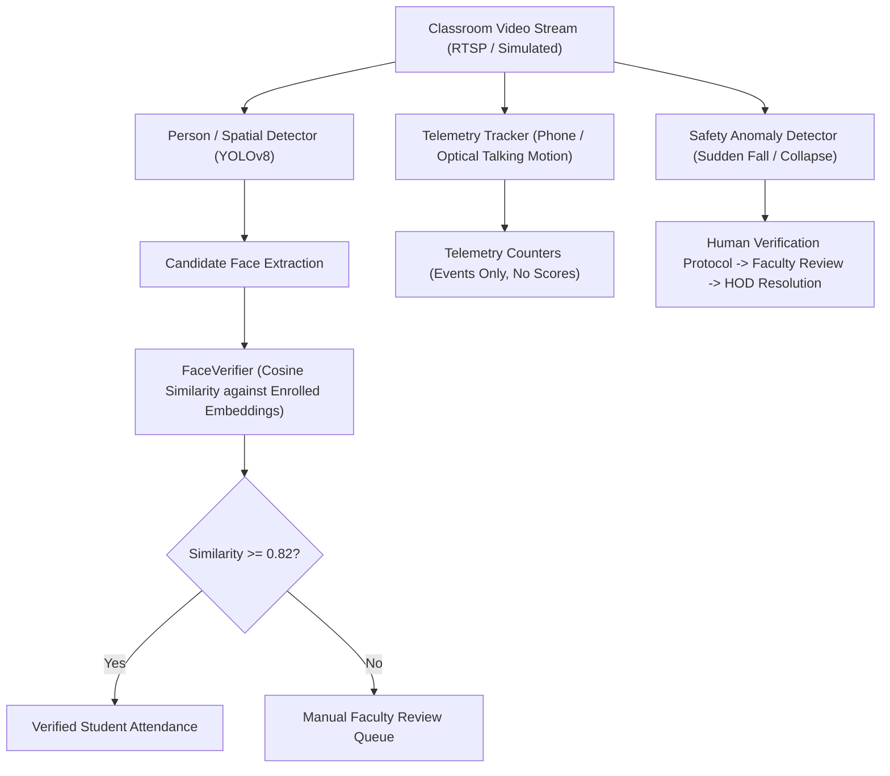

# ClassSphere — API & Model Configuration Register (Section Q)

## 1. Executive Summary & Foundational Principles
ClassSphere is an institutional SaaS platform for intelligent classroom monitoring and management. It is architected under strict institutional privacy standards:

> **Foundational Privacy Pledge:**
> *"Monitor important events, not personalities."*
> *"Events only. No scores. No labels."*

The system strictly decouples spatial bounding-box object detection (YOLO) from biometric identity verification (enrolled reference cosine similarity), enforces human verification protocols before any safety alerts are acted upon, and provides complete, tamper-evident audit logging for attendance overrides and executive escalations.

---

## 2. Environment Variables & Runtime Configurations

| Variable Name | Default / Example Value | Required In Prod | Description |
| :--- | :--- | :--- | :--- |
| `APP_NAME` | `ClassSphere` | No | Institutional application name displayed across UI/UX |
| `APP_VERSION` | `2.0` | No | Software semantic release version |
| `APP_MODE` | `SIMULATION` / `CONNECTED` | Yes | Global camera operating mode |
| `DATABASE_URL` | `sqlite+aiosqlite:///backend/classsphere.db` | Yes | SQLAlchemy async connection string (`postgresql+asyncpg://...` in prod) |
| `JWT_SECRET_KEY` | *(32+ char high-entropy string)* | Yes | HMAC secret for Argon2id session tokens |
| `JWT_ALGORITHM` | `HS256` | No | Token signing algorithm |
| `ACCESS_TOKEN_EXPIRE_MINUTES` | `60` | No | Access token expiration duration |
| `REFRESH_TOKEN_EXPIRE_DAYS` | `7` | No | Refresh token validity window |
| `TWILIO_ACCOUNT_SID` | `ACxxxxxxxxxxxxxxxxxxxxxxxxxxxx` | Optional | Twilio Verify service account SID for SMS 2FA |
| `TWILIO_AUTH_TOKEN` | `xxxxxxxxxxxxxxxxxxxxxxxxxxxxxxxx` | Optional | Twilio auth token |
| `TWILIO_VERIFY_SERVICE_SID` | `VAxxxxxxxxxxxxxxxxxxxxxxxxxxxx` | Optional | Twilio Verify service instance SID |
| `YOLO_MODEL_PATH` | `models/yolov8n.pt` | No | Object detection model weights location |
| `FACE_MODEL_PATH` | `PENDING EVALUATION` | No | Separate face detection / embedding pipeline |
| `ACTIVITY_MODEL_PATH` | `PENDING EVALUATION` | No | Optical motion analysis for phone & talking detection |
| `FALL_MODEL_PATH` | `PENDING EVALUATION` | No | Anomaly and fall detection model weights |
| `CAMERA_SOURCE` | `simulated://classroom_a101` | Yes | Stream URI (RTSP or internal simulation abstraction) |
| `CORS_ORIGINS` | `["http://localhost:5173", "http://localhost:3000"]` | Yes | Whitelisted frontend origins |

---

## 3. Computer Vision & Model Architecture



### Decoupled Subsystems:
1. **Person & Spatial Localization:**
   - **Model:** Ultralytics YOLOv8 Nano (`models/yolov8n.pt` / OpenCV DNN fallback).
   - **Target Classes:** Person (`class 0`), Cell Phone (`class 67`).
   - **Constraint:** YOLO does **not** perform identity verification or medical diagnostics.
2. **Identity Verification Pipeline (`FaceVerifier`):**
   - **Method:** 128-dimensional embedding cosine similarity.
   - **Enrolled Database:** Reference photos stored under `backend/uploads/references/`.
   - **Match Threshold:** High-confidence match at $\ge 0.82$. Candidates between $0.65$ and $0.82$ route to `MANUAL_REVIEW`. Below $0.65$ route to `PENDING_VERIFICATION`.
3. **Camera Source Abstraction:**
   - **Simulation Mode:** Pre-recorded sequence or synthetically injected bounding boxes. Clearly watermarked `[MODE: SIMULATED DEMO FEED]`.
   - **Connected Mode:** RTSP / HTTP video stream abstraction ready for production institutional NVRs/CCTV.

---

## 4. Database Persistence & Source of Truth

The database architecture is built on SQLAlchemy 2.0 Async ORM supporting both SQLite (`sqlite+aiosqlite`) for zero-dependency development and PostgreSQL (`postgresql+asyncpg`) for institutional production.

### Source of Truth Tables:
- `users`: Institutional identities, Argon2id hashes, role assignments (`STUDENT`, `FACULTY`, `HOD`).
- `departments`, `subjects`, `sections`, `students`, `faculty`: Academic organizational hierarchy.
- `class_sessions`: Time slots, room allocations, active state (`SCHEDULED`, `ACTIVE`, `COMPLETED`).
- `attendance_sessions`: Challenge PINs, photo evidence URLs, verification statistics.
- `attendance_records`: Individual student attendance records with confidence score, method, and manual override tracking.
- `activity_events`: Observable telemetry timestamped per session (Phone handling, talking motion).
- `incident_records`: Emergency fall and safety alerts with full audit trail (`PENDING_FACULTY_REVIEW`, `ACKNOWLEDGED_FACULTY`, `DISMISSED_FACULTY`, `ESCALATED_TO_HOD`, `RESOLVED_HOD`).
- `audit_logs`: Tamper-evident system logs capturing every login, override, and administrative determination.

---

## 5. Local Verification & Execution Commands

### Prerequisites
- Node.js $\ge 18$ and `pnpm`
- Python $\ge 3.10$ and `pip`

### Step 1: Backend Setup & Testing
```powershell
# Set Python path to backend
$env:PYTHONPATH="backend"

# Run automated test suite
python -m pytest backend/tests -v

# Start FastAPI development server on port 8000
python -m uvicorn app.main:app --host 0.0.0.0 --port 8000 --reload
```

### Step 2: Frontend Setup & Build
```powershell
# Navigate to frontend directory
cd frontend

# Install dependencies (if not cached)
pnpm install

# Verify production build and TypeScript compilation
pnpm run build

# Start Vite development server on port 5173
pnpm run dev
```

### Default Institutional Test Credentials
| Role | Email / ID | Password | Portal Group Scope |
| :--- | :--- | :--- | :--- |
| **Student** | `student@classsphere.edu` / `STU-2024-001` | `Password@123` | Overview, Attendance, Class Insights, Notifications, Account |
| **Faculty** | `faculty@classsphere.edu` / `FAC-1001` | `Password@123` | Overview, Classroom, Attendance, Class Intelligence, Safety Centre, Account |
| **HOD** | `hod@classsphere.edu` / `HOD-001` | `Password@123` | Overview, Academic Oversight, Class Intelligence, Safety Centre, Administration, Account |
